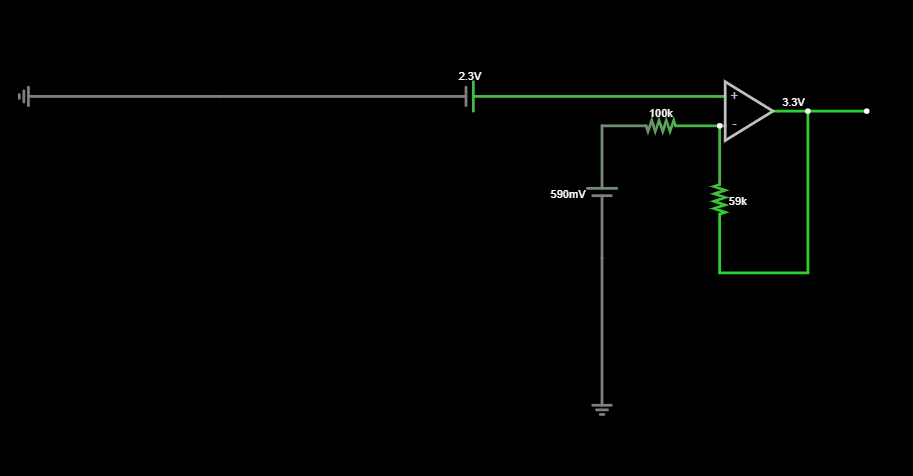
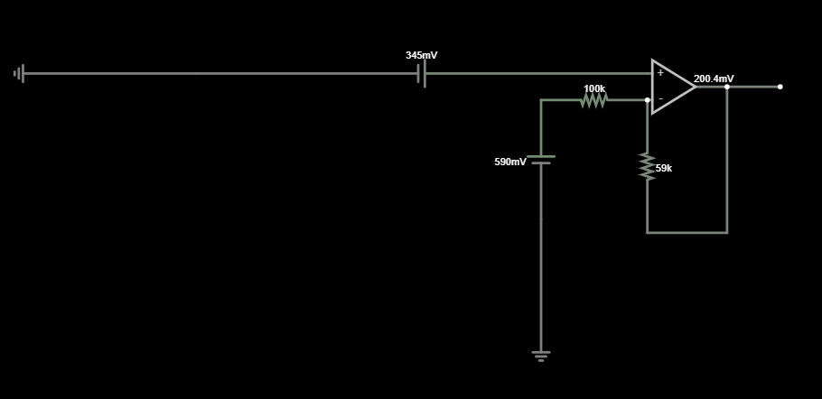
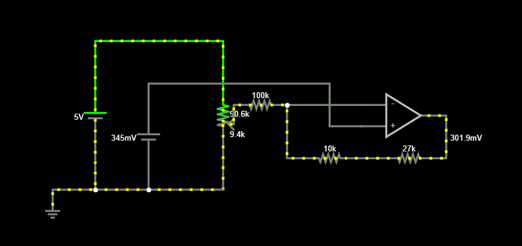
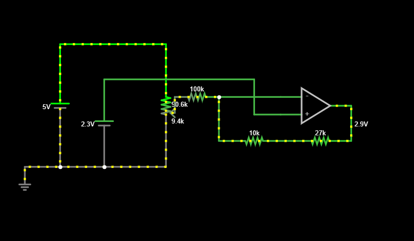

## Andmehõive: Labor 2 — Op-amp, lihtne aga keeruline

**Töömaht:** 32 tundi | **Hindamine:** 20 punkti | **Meeskond:** 3 tudengit | **Välja antud:** 07.10.26 | **Tellimise kuupäev:** 16.10.26 | **Esimene kaitsmine:** 29.10.26, veebis

## Meeskonna tegelik töö ja tulemused (ülevaade 14.11.2026)

> See on **meeskonna tulemuste kokkuvõte**. Allpool olev laboriülesanne on säilitatud algsel kujul ja selle näidisarve ei käsitleta meie mõõdetud tulemustena. Mõõdetud, arvutatud ja veel kinnitamata näidud on siin eristatud.

### Eesmärk ja lähteandmed

Labor 1 MPX5700AP rõhuanduri kasutatud mõõtevahemik oli ligikaudu **0,345–2,30 V** (laius 1,955 V, umbes **59,2%** 3,3 V ADC vahemikust). Labor 2 eesmärk oli vähendada signaali nihet ning suurendada ADC-le antavat mõõdetavat pingeulatust. 24.–25.10.2026 ehitasime ja mõõtsime LM358P abil kaks füüsilist võimendusahela versiooni; toitepingeks mõõdeti **5,01 V**.

### Võimendi kaks varianti

| Parameeter | Esimene variant | Parandatud variant |
| --- | ---: | ---: |
| Tagasiside takistid | 51 + 10 = 61 kΩ | 27 + 10 = 37 kΩ |
| Takisti võrdluspinge poole | 100 kΩ | 100 kΩ |
| Arvutuslik võimendus | 1,61× | 1,37× |
| Seatud võrdluspinge | 0,590 V | 0,467 V |
| Sihtväljund | 0,20–3,30 V | 0,30–3,00 V |
| Täisvaakumis mõõdetud väljund | 0,200 V | 0,300 V |
| Atmosfääril mõõdetud väljund | u 0,960 V | 0,963 V |
| Puhumisel mõõdetud väljund | 3,124 V | 2,800 V |

Kasutatud seos: `U_out = (1 + Rf / 100 kΩ) · U_sensor − (Rf / 100 kΩ) · U_ref`. Parandatud variandi arvutuslik väljund on sisendi 0,345 V korral umbes **0,300 V** ja sisendi 2,30 V korral umbes **2,978 V**. Need on **valemist arvutatud**, mitte samaaegselt mõõdetud sisend-väljundpaarid. Võimendi mõõdetud väljund puhumisel oli 2,800 V; ülemise sihi täpset saavutamist ei ole kinnitatud.

**Simulatsioonide võrdlus:** algses Falstadi mudelis kasutati 59 kΩ tagasisidet (1,59×), esimese füüsilise skeemi aruandes on 61 kΩ (1,61×). Parandatud skeemi Falstadi pildid ning [imporditav lähtefail](docs/falstad-corrected-circuit.txt) on allpool [simulatsiooni osas](#falstadi-simulatsiooni-areng). Arenduspäevikus kirjeldatakse ka 10 mV suurusjärgus müraallikaga tehtud simulatsiooni. Falstadi väärtusi ja reaalse makettplaadi mõõtmisi ei tohi omavahel segi ajada.

### ADC samm ja mõõtelogi

MPX5700AP nominaalse tundlikkuse, umbes 5 V toite ja 12-bitise 0–3,3 V ADC eeldusel on **teoreetiline** rõhusamm enne võimendit umbes **125 Pa/samm**, pärast 1,37× võimendust umbes **91 Pa/samm**. See on lahutusvõime arvutus, **mitte mõõdetud SNR-i paranemine**.

[25.10.2026 rõhulogis](logs/Tool_logs25102026.md) on **145 mõõterida**: ADC vahemikus **293–3543**, pinge vahemikus **263–2879 mV**. Programmi kuvatud `P_abs` oli 12,8–409,8 kPa ja `P_gauge` −28,6 kuni +368,5 kPa. Neid rõhunumbreid ei saa otse kinnitatud tegelikuks rõhuks pidada: käivituse atmosfäärinäit **41,3 kPa** ei sobi varasema ligikaudu 97 kPa näiduga. Rõhu teisendus võimendi järel vajab kontrollimist. Logis ei ole katsete ajatemplite, pumba ON/OFF ega `raw/opamp` konfiguratsiooni veerge.

### 14.11.2026 — kahekanaliline ostsilloskoobivaatlus

14.11.2026 salvestati GW Instek GDS-1072A-U ostsilloskoobil CH1 (kollane) ja CH2 (sinine) rõhumuutusele reageerivad signaalid. Mõlemad jäljed on samal ekraanil ning fotodel on nähtavad nii signaalitaseme tõus kui ka langus. Mõõterežiimis kuvati ajabaas **500 ms/div (ROLL)**. Ühel fotol on **Vmax CH1 = 2,64 V**, **Vmax CH2 = 1,89 V**, **Vmin CH1 = 0,00 V**, **Vmin CH2 = 0,60 V**, **Vpp CH1 = 2,64 V** ning **Vpp CH2 = 1,29 V**. Need on ekraanilt loetud väärtused, mitte valideeritud gain/SNR-i tulemus.

Mõõteprotseduur, fotode tähendus ja piirangud: [`docs/oscilloscope_2026-11-14.md`](docs/oscilloscope_2026-11-14.md). Kanalite mõõtepunktide ja 1×/5×/10× sondi koefitsientide vastavus vajab lõpliku pingevõrdluse jaoks kinnitamist. Foto ei asenda 30 + 30 impulsi ajatemplitega CSV-d, spektrit ega mõõdetud SNR-i.

### Failid ja tööde hetkeseis

| Tõendusmaterjal | Asukoht / märkus |
| --- | --- |
| Kahe füüsilise variandi aruanne | [`docs/Lab2_aruande.md`](docs/Lab2_aruande.md) |
| Esimese ebaõnnestunud kokkupaneku ajalugu | [`docs/Lab2_aruande_old.md`](docs/Lab2_aruande_old.md), **mitte lõplik skeem** |
| Arenduspäevik | [`docs/development-log.md`](docs/development-log.md) |
| Falstadi pildid ja parandatud skeemi eksport | [`docs/images/`](docs/images/), [`docs/falstad-corrected-circuit.txt`](docs/falstad-corrected-circuit.txt) |
| Kasutatud komponendid ja tellimisvajadus | [`docs/bom.md`](docs/bom.md); **16.10 ostutellimuse esitamine ei ole kinnitatud** |
| Pumba juhtimine ja taastatud katsetulemused | [`docs/pump_control.md`](docs/pump_control.md) |
| Originaalsed oktoobri mõõteread | [`logs/Tool_logs25102026.md`](logs/Tool_logs25102026.md) |
| AtomS3R rõhumonitor | [`main.cpp`](../../Nutilahendused/lab1/sketch_sep12a/src/main.cpp), teise aine kaustas |
| Python jadaliidese logija | [`log_serial.py`](../../Nutilahendused/lab1/sketch_sep12a/tools/log_serial.py) |
| Pumba juhtimise Python-kood | [`suck_until_pressure.py`](../../Nutilahendused/lab1/sketch_sep12a/tools/suck_until_pressure.py) |
| MG400 kohalik veebirakendus | [`server.py`](../../MG400%20python%20apps/mg400_grid_website_v18/server.py) |
| Labor 2 lähtekood ja ajaloolise Atomi püsivara koopia | [`src/README.md`](src/README.md), [`src/atom_pressure_original/`](src/atom_pressure_original/) |
| **Uus eraldi 100 Hz Lab 2 püsivara (katsetamata)** | [`src/atom_pressure_100hz/`](src/atom_pressure_100hz/), [`src/capture_100hz.py`](src/capture_100hz.py). Originaalset Nutilahendused programmi ei muudeta. |
| 25.10 tekstlogist taastatud 145-realine CSV | [`data/pressure_20261025_legacy.csv`](data/pressure_20261025_legacy.csv), [`data/README.md`](data/README.md); `config=unverified`, puuduvad ajatemplid |
| Jupyter ja olemasolevate pärisandmete graafikud | [`notebooks/pressure_analysis.ipynb`](notebooks/pressure_analysis.ipynb), [`notebooks/README.md`](notebooks/README.md); nüüd kaks Labor 1 raw ajagraafikut ja üks Labor 2 järjekorranumbri graafik; mõõdetud SNR veel kinnitamata |
| Signaalianalüüsi aruanne | [`docs/signal_analysis.md`](docs/signal_analysis.md) — 129 + 983 + 145 päris mõõterida, kirjeldav pinge kõikumine ning ADC teoreetiline resolutsioon; raw/opamp SNR ei ole tõendatud |
| Labor 1 ja projekti juhised | [`../lab1/README.md`](../lab1/README.md), [`../AGENTS.md`](../AGENTS.md) |

**Kinnitatud:** vooluringi kokkupanek, kahe versiooni multimeetrimõõtmised kolmes rõhuolukorras, Falstadi simulatsioonid, komponentide loend, osa programme ja elektriliste väärtustega logi.

**Osaliselt dokumenteeritud või kinnitamata:** kahekanalilised ostsilloskoobivaatlused on kirjeldatud (fotode GitHubi lisamine veel pooleli), kuid sondide skaalakoefitsientide kontroll ja võrreldav arvuline analüüs puuduvad; sama pumba impulsi vähemalt 30 mõõtmist mõlemas `raw/opamp` konfiguratsioonis koos ajatempliga CSV-s, võrreldavad spektrid ja SNR, kolme haardeolukorra pumba käivitused minutis ning `poolik haare` tuvastamise aeg sekundites. Meeskonna kinnitusel tehti pumbakatsed, kuid nimetatud arvulisi kokkuvõtteid ei saa säilinud failidest usaldusväärselt taastada. Labor 2 kaustades `src/`, `data/` ja `notebooks/` on nüüd eraldi lähtekoodikoopiad, tegelikust tekstlogist teisendatud CSV ning analüüsi ettevalmistav notebook (vt allpool). Lisaks on `src/atom_pressure_100hz/` all **eraldiseisev uus kavandatud 100 Hz püsivara** ja `src/capture_100hz.py` logija; neid ei ole seni päris AtomS3R-ga kompileeritud ega mõõdetud. See **ei tähenda**, et 100 Hz võrdluskatsed või tegelik SNR oleksid juba valmis. Git tag `data-acquisition-lab2` on endiselt puudu.

**Ohutus:** LM358P töötab 5 V toitega, kuid AtomS3R ADC sisendile ei tohi anda rohkem kui **3,3 V**. Enne ADC ühendamist ja pärast skeemi muutmist tuleb väljund mõõta multimeetriga.

---

## Õppejõu algne laboriülesanne (säilitatud)

Järgnev on algne ülesandetekst koos nõuete kontrollnimekirjaga. Ülal on meie töö tegelikud tulemused; lõpetamata tööde ruute ei ole siin automaatselt märgitud.

### Kuidas see dokument töötab

* Repo ja töökord on Laborist 1 olemas ja samad.
* Too sellest dokumendist oma projekti repo juurde see, mida vaja: selle labori kaust, `README.md`, kuhu lähevad su enda numbrid, otsused ja KAARDISTA ISE vastused, ja failid, mida kontrollnimekiri nimetab. Tervet dokumenti üle kopeerida ei ole vaja.
* Skeemid ja simulatsioonid lähevad dokumenti pildina, pildi juurde link elavale failile, et teine saaks selle lahti teha ja edasi muuta.

### Eesmärk

Laboris 1 läks andur otse ADC-sse ja vahel ei olnud midagi. See oli meelega. Nüüd on näha, mis sellest välja tuli.

MPX5700AP väljund liigub pumba kogu ulatuses −70 … +110 kPa vahemikus 0,40 … 1,56 V. See on umbes kolmandik ADC vahemikust. Ülejäänud kaks kolmandikku seisavad kasutult, ja üks ADC samm on umbes 125 Pa. Sa ei mõõda halvasti sellepärast, et andur oleks halb — sa mõõdad halvasti sellepärast, et signaal on ADC jaoks liiga väike ja istub valel kõrgusel.

See labor ehitab vahele astme, mis lahutab nihke maha ja võimendab signaali nii, et ta täidab ADC vahemiku, ja mõõdab ära, mis sellest muutus.

**Miks me võimendame, mitte ei vaheta andurit.** Õige lahendus oleks vale skaala asemel õige skaala: väiksema vahemikuga diferentsiaalandur, mille väljund juba täidab ADC vahemiku. Seda anduri klassi (MPX5100DP) Mouser enam ei müü — tootmine on lõpetatud ja asendust õigeks ajaks ei olnud. Nii et me jääme MPX5700AP juurde ja parandame skaala ahelaga. Nii see päris töös käibki: allikas on selline, nagu ta on, ja puudujääk kaetakse ahelaga. See on ka aus piir — võimendus teeb signaali ADC jaoks suuremaks, aga ei too tagasi infot, mida andur ei mõõtnud. Seda vahet mõõdad selles laboris ise.

Kui su meeskond leidis Laboris 1 teise, saadaoleva anduri, on numbrid teised ja võib-olla ka suund teine: andur, mille väljund käib 4,7 V-ni, ei vaja võimendust, vaid jagurit. **Aste tuleb sinu anduri järgi, mitte selle lehe järgi.** Selle lehe numbrid on MPX5700AP omad ja nad on siin näitena.

Ja kõige tähtsam: aste ei ole eesmärk omaette. Ta on olemas ühe konkreetse olukorra pärast.

Napp on klaasi peal, aga serv jäi natuke lahti — haare on poolik. Kast ei tea seda. Rõhk langeb, pump käivitub, jõuab väljalülitusrõhuni, lülitub välja, leke viib rõhu kohe tagasi ja pump käivitub uuesti. Kast jääb sellesse lühitsüklisse kinni. Väljastpoolt näeb ta välja nagu töötav kast: rõhk on vahemikus, ekraan ütleb, et hoiab. Aga ta ei hoia, ta pumpab auku.

Poolik haare ei erine korralikust haardest rõhu **väärtuse** poolest. Ta erineb selle poolest, **kui kiiresti rõhk langeb** pärast pumba väljalülitumist. Korraliku haardega langeb ta aeglaselt, poolikuga kiiresti. Ja just see vahe jääb Labori 1 signaalis müra ja kvantimise alla: üks ADC samm on 125 Pa, aeglane langus on rida ühesuguseid numbreid ja sa näed teda alles siis, kui ta on juba suur. Astme järel on samm mitu korda väiksem ja seesama langus tuleb välja palju varem. Uut infot sa juurde ei saa — sa saad kätte selle, mis oli olemas, aga peidus.

Miks see üldse loeb: selle otsa peal ripub polükarbonaatklaas. "Vaakum on käes" ei ole otsus, mille peale tõsta — see number võib olla laitmatu ka hetk enne, kui klaas lahti tuleb. Otsus, mille peale tõsta, on "vaakum **püsib**", ja püsimine on kalle, mitte väärtus. Kallet ennast sa selles laboris veel ei arvuta, see on L3 töö. Aga kallet ei saa arvutada signaalist, milles teda näha ei ole, ja selle teeb nähtavaks aste.

Nii et Labori 1 pumbajuhtimine käib lõpus uue signaali pealt läbi: kitsam riba, vähem käivitusi minutis, poolik haare eristub varem. Need numbrid ütlevad, kas aste oli seda väärt. Võib ka selguda, et ei olnud. Ka see on tulemus, kui ta on numbriga.

Selles laboris on neli asja:

1. **Mis on puudu.** Mõõda Labori 1 signaal üle ja ütle numbritega, mida aste peab tegema.
2. **Aste.** Falstadis enne, maketeerimisplaadil pärast. Arvuta siht, ehita, mõõda.
3. **Parandus.** Mõõdetu ei lähe arvutatuga kokku. Selgita, miks, ja arvuta uuesti.
4. **Vahe.** Sama impulss läbi mõlema, spektrid kõrvuti, ja Labori 1 pumbajuhtimine uue signaaliga.

Esimesel päeval uusi osi ei ole. Ehita sellest, mis riiulil on, ja kirjuta puuduv tellimuseks, mis läheb välja 16.10.

*See on elav dokument. Uuenda eesmärke, kui need töö käigus muutuvad — uued teadmised teevad vanad eesmärgid vahel mõttetuks. Mõte on hoida meeskond kogu aeg sihil, et ei eksitaks detailide metsa ja põhiprobleem ei jääks lahendamata.*

**KAARDISTA ISE — eesmärk nii, nagu ta tegelikult välja tuli.**

### Kontrollnimekiri

**Peab olema tehtud**

- [ ] Labori 1 signaal üle arvutatud: Pa ühe ADC sammu kohta, mitu protsenti ADC vahemikust kasutusel, mida aste peab tegema.
- [ ] Falstadi skeem astmest, takistite väärtused sealt, müraallikas sees.
- [ ] Aste maketeerimisplaadil, multimeetriga mõõdetud kolmes rõhus, ostsilloskoobi pilt sisendist ja väljundist korraga.
- [ ] Esimese versiooni hälve otstes üles kirjutatud ja seletatud, aste ümber arvutatud, uus mõõtmine vana kõrval.
- [ ] Sama impulss logitud mõlemas konfiguratsioonis, spektrid kõrvuti Labori 1 omadega.
- [ ] Pa ühe ADC sammu kohta ja SNR enne ja pärast.
- [ ] Labori 1 pumbajuhtimine uue signaaliga üle mõõdetud, uued numbrid vanade alla failis `docs/pump_control.md`.
- [ ] Poolik haare logitud mõlema signaaliga, eristamise aeg sekundites välja kirjutatud.
- [ ] Tellimus 16.10 failis `docs/bom.md`.
- [ ] Repo ja arenduspäevik täidetud, tag `data-acquisition-lab2`.

**KAARDISTA ISE — kuupäevad ja sinu enda sammud.**

### Sisendid

* Laborist 1: maketeerimisplaat koos anduriga, 100 Hz logija, CSV formaat, toore signaali spektrid, `pump_control.md`, `sensor_choice.md`.
* Riiulilt: LM358N, takistite ja kondensaatorite komplekt, teine maketeerimisplaat, multimeeter, ostsilloskoop.
* Õppejõult: MG400 koos pumbakastiga.
* 3D printimise L2-st: pesa, kus klaas on kindlas kohas — päris tõstmise rõhukõver käib selle pealt.
* Nutikate Lahenduste L2-st: Atomi leht, kuhu anduri seaded ja testinupp lähevad.

### Vahendid

1. AtomS3, USB-C kaablid
2. Sinu andur Laborist 1
3. LM358N ×5, takistite ja kondensaatorite komplekt, kaks maketeerimisplaati, juhtmed
4. Multimeeter
5. Ostsilloskoop, kaks kanalit
6. MG400 koos pumbakasti, vooliku, T-liitmiku ja iminapaga
7. Arduino IDE või PlatformIO; Python 3, pyserial, Jupyter Lab, numpy, pandas, scipy, matplotlib
8. Falstad
9. Git

*Kui plaan muutub, uuenda ka vahendeid, või tee draw.io skeem, mis näitab, kuidas asjad omavahel töötavad.*

**KAARDISTA ISE — mida sa päriselt kasutasid.**

### Taustainfo

* **LM358** — üherea toitega op-amp. Andmelehelt vaata üht asja enne kõike muud: kui lähedale väljund toitepingele üldse jõuab. 5 V toitel jääb LM358 ülemine ots umbes 3,5 V peale. See number otsustab, kas su siht üldse ära mahub.
  [https://www.ti.com/product/LM358](https://www.ti.com/product/LM358)
* **MPX5700AP andmeleht**
  [https://www.nxp.com/docs/en/data-sheet/MPX5700.pdf](https://www.nxp.com/docs/en/data-sheet/MPX5700.pdf)
* **Falstad**
  [https://www.falstad.com/circuit/circuitjs.html](https://www.falstad.com/circuit/circuitjs.html)
* **ESP32 ADC** — vahemik, sumbuvus ja mittelineaarsus ülemises otsas
  [https://randomnerdtutorials.com/esp32-adc-analog-read-arduino-ide/](https://randomnerdtutorials.com/esp32-adc-analog-read-arduino-ide/)
* **Kuidas ADC päriselt töötab** — lühike video, kui kvantimissamm on veel hägune mõiste. Vaata enne osa 1, siis on "Pa ühe ADC sammu kohta" lihtsalt aritmeetika.
  [https://www.youtube.com/watch?v=g4BvbAKNQ90](https://www.youtube.com/watch?v=g4BvbAKNQ90)
* **Kuidas op-amp töötab** — sama sari, sama tase. Vaata enne osa 2, siis ei ole Falstadis kolmnurk lihtsalt kolmnurk.
  [https://www.youtube.com/watch?v=kbVqTMy8HMg](https://www.youtube.com/watch?v=kbVqTMy8HMg)
* **Op-amp konsultatsioon** — nihke ja skaleerimise ahel, tüüpilised vead, ostsilloskoobi kasutamine. Aeg lepitakse meeskondadega jooksvalt kokku. Tule sinna mõõdetud numbritega: "ei tööta" ei ole küsimus, "arvutasin X V, mõõdan Y V, siin on mõlemad" on.
  [Ainepassi kontakttunnid](../../Data%20Acquisition/SVNC.00.325_SO%20EST%20v2.md#kontakttundide-ajakava)
* **scipy.fft ja `scipy.signal.welch`**
  [https://docs.scipy.org/doc/scipy/reference/fft.html](https://docs.scipy.org/doc/scipy/reference/fft.html)
* **Pingejagur ja võimendus.** Kaks valemit, mille peal kogu see labor seisab. Kirjuta mõlemad oma käega paberile välja, enne kui Falstadi avad. Kui sa neid ise välja kirjutada ei oska, ei oska sa ka öelda, kas Falstad valetab.

*Lisa siia oma allikaid ja kasulikku infot, mis aitaks sul projektist aru saada ka aastaid hiljem, kui selle uuesti lahti teed.*

**KAARDISTA ISE — sinu allikad.**

### Osad

#### 1. Mis on puudu

Ava Labori 1 CSV ja spekter. Arvuta kolm asja: mitu volti su anduri väljund pumba kogu ulatuses liigub, mitu protsenti see on ADC vahemikust, ja mitu Pa on üks ADC samm.

MPX5700AP näitel. Ülekandefunktsioon on `Vout = 5 · (0,0012858 · P + 0,04)`, kus P on kPa absoluutset. Pumba −70 kPa on 31 kPa absoluutset ja +110 kPa on 211 kPa, ehk väljund liigub 0,40 V-st 1,56 V-ni. Vahemik on 1,16 V. ADC samm on 3,3 V / 4096 ≈ 0,81 mV. Anduri tundlikkus on 5 · 0,0012858 ≈ 6,43 mV/kPa. Üks ADC samm on seega umbes 0,81 / 6,43 ≈ 0,125 kPa ehk 125 Pa.

Siin on kaks erinevat "raisku läinud" numbrit ja mõlemad on õiged, aga nad ei ole sama asi:

* **Anduri skaalast** kasutad sa umbes neljandikku: 180 kPa 700-st. Seda sa selles laboris ei paranda. See on anduri valiku tulemus ja ta jääb sinna, kuni andur vahetub.
* **ADC vahemikust** kasutad sa umbes kolmandikku: 1,16 V 3,3-st. **Selle parandab aste.**

Ütle mõlemad välja ja ära aja neid segamini. Ainult teine neist on see, mille kallal sa siin tööd teed.

Nüüd otsus. Mida aste peab tegema? Kui väljund on väike, siis nihe maha ja võimendus peale. Kui väljund läheb üle 3,3 V, siis jagur — ja tasub kohe teada, et jagur jagab signaali ja müra ühesuguse teguriga, ehk suhe nende vahel ei muutu. Jagur päästab ADC viigu, mitte mõõtmise. Võimendus on midagi muud.

Võimenduse number tuleb sellest, et anduri vahemik peab saama ADC vahemikuks. Päris nulli sa ei sihi — jäta alumisse otsa natuke varu, sest ADC ise on kõige alumises otsas mittelineaarne. Esimene siht: **0,2 … 3,3 V**, ehk 3,1 V ulatust. MPX5700AP puhul on võimendus 3,1 / 1,16 ≈ 2,7.

Ja ülemine ots: op-ampi toide on 5 V ja LM358 väljund jääb ülemisest railist umbes 1,5 V allapoole, ehk ulatub ~3,5 V-ni. 3,3 V mahub sinna alla ära. Vaata see number oma andmelehelt üle: kui sa toidad op-ampi hoopis 3,3 V-st, on rail piirav ja siht peab olema madalam.

Nii palju arvutusest. Kas see siht ka plaadil peab, on osa 2 küsimus ja osa 3 vastus. Ära vaata ette.

Kirjuta üles: anduri väljundi vahemik voltides; mitu protsenti see on ADC vahemikust; Pa ühe ADC sammu kohta praegu; mida aste peab tegema, mis sihtvahemikuga ja mis võimendusega; kui su andur on teine kui MPX5700AP, siis kõik needsamad numbrid oma anduri andmelehelt.

#### 2. Aste, esimene versioon

Kui see ei tööta falstadis ei tööta see ka makett plaadil.

Andur on Falstadis pingeallikas oma vahemikuga. Aste võtab ühe sisendi andurilt ja teise viitepingelt. Väljund peab olema 0,2 V, kui andur on alumises otsas, ja 3,3 V, kui ta on ülemises. Kaks tingimust, kaks võrrandit — takistite väärtused ja viitepinge tulevad sealt, mitte pakkumise teel.

Pane tähele, et viitepinge ei ole täpselt anduri alumine ots. Ta on sellest nii palju allpool, et väljund maanduks 0,2 V peale, mitte nulli. Kui sa selle vahe ära unustad, on kogu kõver paigast ära.

Siis tee üks asi, mis ütleb, miks siin üldse op-amp on. Pane müraallikas mõlema sisendi ühisesse maasse ja vaata, mis väljundis juhtub. Siis pane sama müraallikas ainult ühte sisendisse ja vaata uuesti. Esimesel juhul kaob ta suures osas ära, teisel juhul läheb ta võimendatult läbi. Kirjuta üles, mitu korda vahe oli.

Siis maketeerimisplaadile. Toide 5 V — ja mõõda see toide multimeetriga ka päriselt ära ning kirjuta üles. USB "5 V" ei ole alati 5,00 V. Seda numbrit läheb sul osas 3 vaja.

Multimeeter enne Atomit, mitte pärast. Mõõda astme väljund kolmes rõhus: atmosfäär, täis imemine, täis puhumine. Iga mõõtmise juurde kirjuta arvutatud väärtus ja vahe.

Ja nüüd see, mille pärast siin niimoodi tehakse: **ära paranda veel midagi.** Vaata otsi eraldi. Kas täis imemine annab päriselt 0,2 V või jääb kuhugi kinni? Kas täis puhumine annab 3,3 V või vähem? Kui vahe on suurem kui paar protsenti, ära hakka takisteid vahetama — kirjuta number üles ja mine osasse 3. Selle vahe põhjus ongi see, mida see labor sulle õpetab, ja sa ei õpi seda, kui sa ta ära parandad, enne kui ta üles kirjutad.

Ostsilloskoop kahe kanaliga: anduri väljund ja astme väljund, sama impulsi peal, üks pilt. Otsi sellelt pildilt üht asja: kas väljundi tipp on ümar nagu sisendil või lame. Lame tipp on vastus.

Kirjuta üles: takistite väärtused ja viitepinge, ja kuidas sa nendeni jõudsid; Falstadi eksport ja pilt dokumenti, koos lingiga elavale failile; müra vahe ühises maas ja ühes sisendis; mõõdetud toitepinge; mõõdetud pinge kolmes rõhus arvutatu kõrval, vahe eraldi välja kirjutatud mõlemas otsas; ostsilloskoobi pilt.

#### 3. Parandus

Nüüd, kui numbrid on paberil, tuleb seletus. Kolm põhjust, miks su aste ei teinud seda, mida arvutus lubas.

**Ülemine ots.** LM358 ei ole rail-to-rail. 5 V toitel jääb väljund umbes 1,5 V ülemisest railist allapoole, ehk ~3,5 V. Aga su toide ei ole 5,00 V: USB annab tihti 4,75 V ja siis on lagi 3,25 V. Sinu siht oli 3,3 V. Ta ei mahtunud sinna kunagi ära. Otsa lamedus ei tähenda, et rõhk lakkas kasvamast — see tähendab, et op-amp lakkas järgnemast.

**Alumine ots.** Sama asi teises otsas, aga kavalam. Andmeleht ütleb, et väljund jõuab maast paari millivoldi kaugusele, ja see on tõsi — *küllastuses*. Lineaarses töös mitte. LM358 väljundaste on kõige viimases paarisajas millivoltis kõige halvem: allatõmme on nõrk ja juhtimine läheb seal ühelt transistorilt teisele üle. Sinu 0,2 V on täpselt selle sees. Väljund näitab mingit numbrit, aga see number ei ole enam anduriga sirges suhtes. See on hullem viga kui lame tipp, sest ta ei näe katki välja.

**Ja ADC ise.** ESP32 ADC on mittelineaarne mõlemas otsas — all umbes 0,1 V kandis, ülal juba enne 3,3 V. Isegi ideaalse op-ampiga ei tasuks päris otstesse sihtida.

**Miks Falstad seda ei näidanud.** Falstadi op-amp on ideaalne mudel. Ta saturub railide vastu ja rohkem ta sulle ei ütle. Ristumismoonutust, nõrka allatõmmet ja tegelikku toitepinget seal ei ole. Simulatsioon ei valetanud — ta lihtsalt ei tea seda, mida sa talle ei öelnud. Kirjuta see lause arenduspäevikusse; ta kehtib iga simulatsiooni kohta, mille sa selles õppekavas veel teed.

Nüüd arvuta uuesti. Uued sihid: **0,3 V alumises otsas ja 3,0 V ülemises**, ehk 2,7 V ulatust. MPX5700AP puhul võimendus 2,7 / 1,16 ≈ 2,3. Viitepinge tuleb samamoodi nagu enne, ainult 0,3 V jaoks. Kui su toide mõõtes oli oluliselt alla 5 V, arvuta ülemine siht selle pealt, mitte sildi pealt.

Kui see osa jääb segaseks, ära jää üksi nokitsema: op-amp konsultatsioon on täpselt selle jaoks ja osa 2 mõõtmised on parim asi, mis sul sinna kaasa võtta on. Aeg lepitakse kokku siis, kui meeskond selleni jõuab.

Sa kaotad sellega 18% ADC vahemikust. Võidad selle, et mõlemas otsas on mõõtmine ikka veel lineaarne. Lame või kõver ots ei ole mõõtmine — ta on null infot ja vale number pealekauba. 18% on selle eest odav hind.

Vaheta takistid, mõõda needsamad kolm rõhku uuesti ja pane numbrid vanade kõrvale. Nüüd peab mõõdetu arvutatuga kokku minema kõigis kolmes punktis. Kui ei lähe, on midagi muud viltu — otsi see üles enne, kui edasi lähed. Osa 4 logib parandatud astme, mitte esimese.

Kirjuta üles: uued takistid, viitepinge ja võimendus; mõõdetu kolmes rõhus arvutatu kõrval, esimese versiooni numbrite kõrval; mitu millivolti oli esimese versiooni hälve kummaski otsas; üks lause selle kohta, kuidas sa edaspidi op-ampi sihtvahemikku valid ja mille pealt.

#### 4. Vahe

Logija saab CSV-sse veeru `config` väärtustega `raw` ja `opamp`. Labori 1 ahelat ei võeta koost lahti — võrdlus on olemas ainult siis, kui mõlemad on korraga olemas ja sama päeva sama impulss käib mõlemast läbi.

Sama pumba impulss, vähemalt 30 korda kummaski konfiguratsioonis, üks CSV.

Spektrid kõrvuti Labori 1 omadega, samad teljed, kPa. Labori 1 tipud on sul juba nimedega. Vaata, millised neist jäid ja millised muutusid, ja pane tähele: võimendus tõstab ka tippe. Tipp, mis läks kaks korda kõrgemaks, ei ole uus müraallikas — ta on vana müraallikas, mida sa nüüd paremini näed.

Ja siis aus küsimus, mille pärast see osa olemas on. Võimendus võimendab ka anduri enda müra. ADC sammu müra ta vähendab, see on kindel ja seda näitab Pa ühe sammu kohta. Anduri müra ta ei vähenda. **Kas SNR paranes, või paranes ainult lahutusvõime?** Vasta numbriga, mitte arvamusega. Signaal on platoo miinus baasjoon, müra on platoo standardhälve, mõlemad kPa-des.

Ja lõpuks see, mille pärast kogu asi tehti. Pane Labori 1 pumbajuhtimine uue signaali peale. Samad kolm olukorda, mis Laboris 1: napp klaasil, napp õhus, voolik korgiga. Kas riba saab kitsamaks? Kas käivitusi minutis jääb vähemaks? Kas napp õhus läheb ikka veel lühitsüklitesse?

Ja siis neljas olukord, mida Laboris 1 ei olnud: **poolik haare**. Pane napp klaasile nii, et serv jääb lahti — natuke üle klaasi serva, või õhuke riba teipi napa alla. Lase pumbal välja lülituda ja logi langemine nagu ikka. Tee sama kaks korda, toore signaaliga ja astmega, ja vasta ühele küsimusele: **mitu sekundit kulub, enne kui poolik haare on korralikust eristatav?** Sekundites, mõlema konfiguratsiooni kohta. See on kogu selle labori mõte ühe numbrina.

Uued numbrid lähevad `docs/pump_control.md` vanade alla, kuupäevaga. Vanu ei kustutata. Kui riba läks kitsamaks, aga pump käivitub nüüd sagedamini, oled sa midagi paremaks teinud ja midagi halvemaks — kirjuta mõlemad välja ja ütle, kumb sinu jaoks kaalus üles.

Kirjuta üles: Pa ühe ADC sammu kohta enne ja pärast; SNR dB-des enne ja pärast; mis spektris muutus; uus riba, seisuaja alampiir ja käivitused minutis kolmes olukorras vanade kõrval; pooliku haarde eristamise aeg sekundites mõlema signaaliga; üks lause, kas aste oli seda väärt, ja mille pealt sa seda ütled.

**KAARDISTA ISE — vastused.** Iga osa kohta: numbrid, ühikud, kus fail on. Tegemata asja kohta üks rida, miks.

### Ohutus

* USB ja 5 V välja, enne kui juhet liigutad.
* **ADC viik ei kannata 5 V.** Aste toidetakse 5 V-st ja tema väljund võib vea korral minna kõrgemale kui 3,3 V. Mõõda väljund multimeetriga üle, enne kui ta Atomi külge läheb — ja uuesti iga kord, kui sa takistit vahetad. See on ainus koht selles laboris, kus sa saad midagi päriselt katki teha.
* Pumbakast on 24 V. DO liinid ühendatakse siis, kui robot on keelatud ja kast vooluvõrgust väljas.
* Pumba mootor ei ole tehtud iga sekund käivituma. Kui riba kitsamaks lähed, jälgi käivitusi minutis. Kui kast on soojem kui käsi, riba laiemaks.
* Lahtine voolik +110 kPa juures lendab; ära suuna kellegi poole.
* Poolikut haaret katsetad laual, mitte roboti otsas, ja klaasi all ei ole kätt. Poolik haare on tehtud kukkuma — see ongi katse mõte.
* Robot: käed ei ole laual, kui robot on sisse lülitatud. Esimene jooks aeglaselt, hädastopp käeulatuses.
* Selles laboris ei joodeta.

### Komponendid selle labori jaoks

Tellimus läheb välja 16.10.26 ja jõuab kohale enne kaitsmist. Valmis nimekirja ei ole: meeskond paneb tellimuse ise kokku faili `docs/bom.md`, iga rea juures üks lause, milline osa või number seda küsib.

Tellimine käib ühisest tellimistabelist: [https://moodle.ut.ee/mod/url/view.php?id=1535601](https://moodle.ut.ee/mod/url/view.php?id=1535601). Kanna oma read sinna enne tellimise kuupäeva; mida tabelis ei ole, seda ei tellita. Fail `docs/bom.md` jääb sinu reposse põhjenduseks, miks sa just neid asju küsisid.

Mõtle näiteks: kas op-ampe on ja kas varuks ka — üks läheb katki; kas takistite komplektis on need väärtused, mida su arvutus tahab, või pead sa neid kahest kokku panema; kas trimmer oleks siin mõistlikum kui kaks fikseeritud takistit ja mida sa sellega kaotad; kas takisteid on nii palju, et saad astme ühe korra ümber arvutada ja ümber ehitada; kas teine maketeerimisplaat oleks abiks, et Labori 1 ahel saaks alles jääda.

### Hindamiskriteeriumid

| Kategooria | Punktid |
| :--- | :--- |
| Tööfailid — Atomi püsivara mõlema konfiguratsiooniga, logija `config` veeruga, CSV failid | 5 p |
| Analüüs — Pa ühe sammu kohta enne ja pärast, spektrid kõrvuti, SNR, pumbajuhtimise uued numbrid | 5 p |
| Prototüüp — aste plaadil mõõdetud kolmes rõhus enne ja pärast parandust, lõplik väljund mõlemas otsas lineaarne ja kõigis kolmes punktis arvutatuga kooskõlas, pumbajuhtimine töötab uue signaaliga | 5 p |
| Dokumentatsioon — README, arenduspäevik, Falstadi eksport, `pump_control.md` uuendatud, `bom.md`, AGENTS.md | 5 p |
| **Kokku** | **20 p** |

### Kaitsmine

Link git repole, tag `data-acquisition-lab2`.

Kaitsmine on lihtne suuline 15 minuti jutuajamine. Näitad ostsilloskoobil anduri väljundit ja astme väljundit korraga sama impulsi peal, ütled esimese versiooni pealt, kus ta katki läks ja miks, näitad, kuidas pump uue signaaliga seisma jääb, ja avad oma arenduspäeviku. Õppejõud küsib umbes viis küsimust selle kohta, kuidas sa selle tegid. Kui esimesel korral ei õnnestu, tuled uuesti.

Repos on kaustas `data-acquisition/lab2/`: `src/` püsivara ja logijaga, `data/` CSV failidega, `notebooks/` spektrite ja SNR-iga, `docs/` skeemi foto, ostsilloskoobi piltide, Falstadi ekspordi, `pump_control.md` ja `bom.md`-ga, `README.md` selle labori kohta, ja `AGENTS.md` uuendatud.

### Arenduspäevik

**KAARDISTA ISE — päevik.** Üks sissekanne iga töösessiooni kohta, kirjutatud iseendale, nii et inimene, kes seal ei olnud, saab aru. Sissekandeid lisatakse, mitte ei muudeta.

Omadussõnad ei ole tulemused. "Andur oli mürane" ei ole midagi; "±14 LSB rahus, ±40 LSB pumbakasti töötamise ajal" on sissekanne.

**PP.KK.AA — kes olid kohal**
* Tegime:
* Juhtus (numbrid):
* Otsustasime, ja miks:
* Lahti järgmiseks korraks:

### Väljundid ja tulemused

**Väljundid**
* Nutikad Lahendused L2: anduri kalibratsioonikonstandid ja seaded, mis lähevad Atomi lehele.
* 3D printimine L2: rõhukõver päris tõstmiselt ütleb, kas pesa hoiab klaasi seal, kus robot teda ootab.
* Andmehõive L3: aste, mille peale filter ja tuletis ehitatakse.

**KAARDISTA ISE, lõpus.**
* Git repo ja tag:
* Numbrid, mille see labor andis, ühikutega:
* Mida me teeksime teisiti:
* Mida järgmine labor peaks enne alustamist teadma:

### Tagasiside

---

## Falstadi simulatsiooni areng

### Esialgne simulatsioon

Esimene Falstadi variant loodi enne füüsilise makettplaadi lõplikku skeemi ülevaatamist. See kasutas mõõdetud andurivahemikku umbes `0,345–2,30 V`, ideaalset `590 mV` viitepingeallikat, `100 kΩ` takistit ja `59 kΩ` tagasisidetakistit. Simulatsioon andis ligikaudu `0,20 V` täisvaakumis ja `3,30 V` maksimaalse puhumise juures.

See variant oli matemaatiliselt sobiv esimese 0,20–3,30 V sihi kontrollimiseks, kuid ei kopeerinud täpselt hiljem päriselt ehitatud skeemi: päris skeemis tekitati viitepinge B100K potentsiomeetriga ja lõplikus parandatud variandis oli tagasiside `27 kΩ + 10 kΩ = 37 kΩ`.

### Parandatud simulatsioon — päris makettplaadi järgi

30.10.2026 ehitati Falstadi skeem uuesti nii, et ühendused ja komponendid vastaksid parandatud füüsilisele makettplaadile:

- toide `5,01 V`;
- MPX5700AP modelleeritakse pingeallikana, kasutatav sisendvahemik umbes `0,345–2,30 V`;
- B100K potentsiomeeter on ühendatud 5 V ja GND vahele ning selle liugur tekitab umbes `0,467 V` viitepinge;
- viitepinge läheb `100 kΩ` kaudu LM358 inverteerivale sisendile;
- anduri väljund läheb otse mitteinverteerivale sisendile;
- väljundist läheb inverteerivale sisendile tagasiside läbi `27 kΩ + 10 kΩ = 37 kΩ`;
- Falstadi op-ampi väljundpiiriks seati `0…3,5 V`, et mudel oleks LM358-le lähemal.

Parandatud astme seos on ligikaudu

`Uväl = 1,37 · Uandur − 0,37 · Uref`.

Falstadis saadi täisvaakumi sisendiga `345 mV` väljundiks `301,9 mV`, mis vastab hästi parandatud `0,30 V` alumisele sihile. Sisendiga `2,30 V` jäi väljund ligikaudu `2,9–3,0 V` piirkonda, mis vastab parandatud ülemisele sihile.

### Simulatsiooni lähtefail

Parandatud skeemi saab Falstadi uuesti importida failist [`docs/falstad-corrected-circuit.txt`](docs/falstad-corrected-circuit.txt). Falstadis vali **File → Import From Text** ja kleebi faili sisu importaknas olevasse tekstivälja.

Märkus mõõtelogide kohta: Lab 2 logides nähtavaid umbes `300 mV` väärtusi ei kasutata automaatselt toore MPX5700AP minimaalse sisendpingena. Toore anduri vahemik `~0,345–2,30 V` pärineb varasematest otsestest andurimõõtmistest; parandatud astme enda alumine väljundsiht on `~0,30 V`. Logi konfiguratsioon tuleb enne toore anduri kalibreerimiseks kasutamist eraldi kinnitada.

