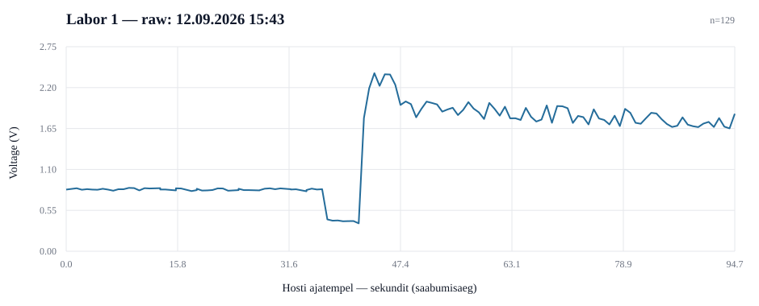
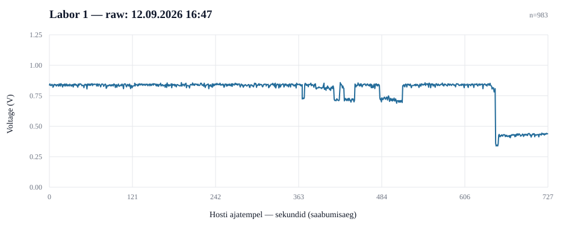
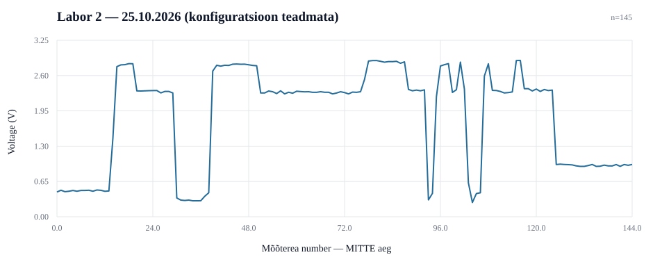

# Andmehõive — Labor 2: signaali analüüs olemasolevatest logidest

**Koostatud:** 14.11.2026  
**Allikad:** kaks Labor 1 jadaliidese logi 12.09.2026, Labor 2 monitori logi 25.10.2026, olemasolev LM358P aruanne ning AtomS3R lähtekood.

## 1. Küsimus ja metoodika

Eesmärk oli võrrelda rõhuanduri signaali ilma võimendita (`raw`) ning parandatud LM358P signaaliga (`opamp`), hinnata ADC resolutsiooni ja signaali-müra suhet (SNR). Esmalt kontrollisime allikate päritolu, ajatemplite olemasolu ning püsivara väljastussagedust. **Üheski säilinud failis ei ole sama pumba impulsi usaldusväärset 100 Hz `raw` ja `opamp` võrdluspaari.** Seetõttu kirjeldame arvutatud resolutsiooni ja üksikute katsete pingekõikumist, kuid **ei esita mõõdetud SNR-i enne/pärast**.

Logide ajaloolised originaalid jäävad oma senistesse kaustadesse. Kaks Labor 1 logi on teisendatud tabeliteks analüüsi hõlbustamiseks, säilitades nende hosti ajatemplid.

## 2. Allikad ja nende piirangud

| Allikas | Uus analüüsitabel | Mõõteridu | Aeg | Konfiguratsioon |
| --- | --- | ---: | --- | --- |
| [Labor 1 alglogi 15:43](../../../Nutilahendused/lab1/sketch_sep12a/logs/pressure-20260912-154318.csv) | [`data/lab1_raw_20260912_154318.csv`](../data/lab1_raw_20260912_154318.csv) | 129 | Hosti vastuvõtuaeg olemas | Otsene signaal, `raw` |
| [Labor 1 alglogi 16:47](../../../Nutilahendused/lab1/sketch_sep12a/logs/pressure-20260912-164737.csv) | [`data/lab1_raw_20260912_164737.csv`](../data/lab1_raw_20260912_164737.csv) | 983 | Hosti vastuvõtuaeg olemas | Otsene signaal, `raw` |
| [Labor 2 alglogi 25.10](../logs/Tool_logs25102026.md) | [`data/pressure_20261025_legacy.csv`](../data/pressure_20261025_legacy.csv) | 145 | Üksikute ridade ajatempleid pole | `unverified` — ei ole õigust automaatselt määrata `opamp` |

Labor 1 AtomS3R originaalkood arvutab 12 lugemi keskmise, oodates lugemite vahel 20 ms, ja lisab pärast väljastust 500 ms pausi. Hosti logide **mediaanvahe on ligikaudu 0,740 s** ehk umbes **1,35 väljastatud mõõterida sekundis**, mitte 100 Hz. Mõnes kohas esineb ebatavaliselt lühike või pikk hosti ajatemplite vahe; seetõttu pole vastuvõtuaja vahed täpsed ADC proovivõtuajad.

## 3. Graafikud päris mõõdetud pingetest







**Telgede tähendus:** Labor 1 graafikute horisontaaltelg näitab arvuti vastuvõtuaega sekundites. Labor 2 graafiku horisontaaltelg on ainult **mõõterea järjekorranumber**, mitte aeg. Need ei ole ühise impulsi kõrvutatud rõhukõverad. Näidatakse *logitud pinget*, mitte ümber arvutatud või täiendavalt silutud rõhku.

### Täheldatud pingepiirkonnad

| Andmestik | Min pinge | Max pinge | Vahemik |
| --- | ---: | ---: | ---: |
| Labor 1 raw 15:43 | 375 mV | 2394 mV | 2019 mV |
| Labor 1 raw 16:47 | 338 mV | 858 mV | 520 mV |
| Labor 2, 25.10, teadmata konfiguratsioon | 263 mV | 2879 mV | 2616 mV |

Labor 2 esimene automaatselt võetud atmosfäärireferents oli `41.3 kPa (LOW)`, erinevalt varasemast ligikaudu 97 kPa näidust. Seetõttu **ei kasuta me selle faili tarkvara arvutatud rõhunumbreid tegeliku rõhu või SNR-i võrdlemiseks**. Kui selles katses oli ühendatud LM358P, pidi tarkvara enne MPX5700AP ülekandevalemit väljundpinge võimenduse ja nihke kaudu tagasi arvutama. Ühenduse konkreetne olek pole logis tõendatud.

## 4. Lühikeste alguslõikude kirjeldav pingekõikumine

Valisime korratavad järjestikused lõigud, et näidata päris mõõteandmete varieeruvust. **See ei ole laboriülesande nõutud SNR**, sest katsete rõhk, koormus, konfiguratsioon ja tingimused ei ole võrreldava katsena kinnitatud.

| Lõik | n | Keskmine pinge | Standardhälve (n−1) | Min–max |
| --- | ---: | ---: | ---: | ---: |
| Labor 1 15:43, esimesed 30 kirjet | 30 | 832,767 mV | 12,042 mV | 809–852 mV |
| Labor 1 16:47, esimesed 30 kirjet | 30 | 837,400 mV | 7,040 mV | 820–849 mV |
| Labor 2 25.10, esimesed 14 kirjet | 14 | 477,214 mV | 11,233 mV | 456–493 mV |

Standardhälve võib sisaldada rõhu aeglast muutust, elektrilist müra, ADC kvantimist ja mõõtmisviga. Katsetingimuste ühtlus pole säilinud dokumentides kinnitatud. Seega ei tohi näiteks 12,042 mV ja 11,233 mV jagatisest järeldada LM358P tegelikku signaali-müra paranemist.

## 5. ADC teoreetiline lahutusvõime

Kasutatud eeldused: MPX5700AP nominaalne tundlikkus `0,0012858 × Vs V/kPa`, `Vs=5,06 V`, 12-bitine ADC nominaalse vahemikuga 0–3,3 V ja parandatud LM358P võimendus `1,37×`.

```text
ADC LSB = 3,3 V / 4096 ≈ 0,8057 mV
Anduri tundlikkus = 5,06 V × 0,0012858 V/(V·kPa) ≈ 6,506 mV/kPa
Raw:   0,8057 / 6,506 × 1000 ≈ 123,8 Pa / ADC samm
Opamp: 123,8 / 1,37 ≈ 90,4 Pa / ADC samm
Teoreetiline kvantimissuhte muutus: 20 × log10(1,37) ≈ 2,73 dB
```

Need on **ideaalmudeli arvutused**, mitte mõõdetud resolutsioon ega SNR. Tegelik ESP32 ADC on mittelineaarne ning anduri ja võimendi enda müra võib olla kvantimismürast suurem.

## 6. Miks ei arvuta veel FFT-d ega mõõdetud SNR-i?

- Labor 1 740 ms hosti väljastusvahe ei võimalda analüüsida 50 Hz müra, pumbamootori sagedusi ega muid kümnete hertside komponente. Hostiaega ei saa muuta tegelikuks 100 Hz proovivõtuajaks.
- 25.10 failil puuduvad mõõteridade ajatemplid ja kinnitatud `raw/opamp` konfiguratsioon. Suvalise 10 ms aja juurde genereerimine annaks kunstliku spektri.
- SNR nõuab vähemalt samal rõhueksperimendil määratud **baseline** ja **plateau** piirkondi ning usaldusväärset pinge-rõhu kalibreeringut mõlemas konfiguratsioonis; sama impulsi puhul on soovitatav samaaegne kahekanaliline salvestus.
- Õppejõu ülesanne nõuab vähemalt **30 impulssi mõlemas konfiguratsioonis**. Säilinud failid ei sisalda selliselt tuvastatud 30 + 30 võrdluskatset.

[Analüüsi notebook](../notebooks/pressure_analysis.ipynb) sisaldab päris logide graafikuid ja arvutusi ning ettevalmistatud kontrolli tulevasele 100 Hz mõõtefailile. Uut püsivara ei käivitatud ega paigaldatud.

## 7. Järeldus

Labor 2 võimendi **füüsilised pingemõõtmised, skeemid ja Falstadi simulatsioon** näitavad, et parandatud LM358P signaalitingimuste mõju ADC kasutatavale vahemikule on arvutatav. Nominaalne rõhuaste väheneb umbes **124 → 90 Pa** ühe ADC sammu kohta. Samas **tõelist `raw/opamp` SNR-i paranemist ja sagedusspektrite erinevust pole võimalik olemasolevatest logidest tõendada**. Need tuleb kaitsmisel selgelt eristada arvutuslikust eelisest.

## 8. Kasutatud kood ja andmete päritolu

Kõik uued CSV koopiad, graafikud ja notebook asuvad **ainult `Data-Aq/lab2` all**. `Nutilahendused`, `MG400 python apps` ning `Data-Aq/lab1` failid on muutmata.
